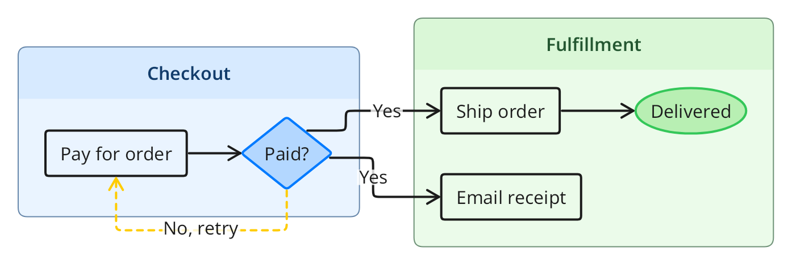
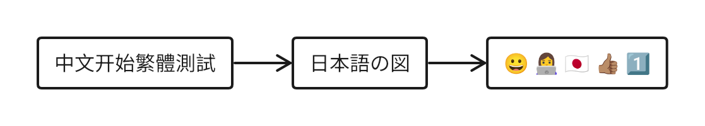

# TextGraph Fonts

Optional local font assets for Chinese, Japanese, and color emoji. The package contains no WASM runtime and does not download fonts during installation. Importing its metadata does not read font binaries. Compatible TextGraph renderers load a font only when displayed text needs it.

Use matching SDK/font versions in production. New numeric releases use patch `0` for stable and `1` through `9` for previews on the `alpha` channel; historical suffixed releases remain installable.

## Example output

<!-- public-preview:start -->

```textgraph
(horizontal)

checkout(primary): Checkout {
  pay -> payment
  payment ->(dashed warning) pay : No, retry
}

fulfillment(success): Fulfillment {
  ship -> delivered
  email
}

payment -> ship : Yes
payment -> email : Yes

pay: Pay for order
payment(diamond fill primary): Paid?
ship: Ship order
email: Email receipt
delivered(ellipse fill success): Delivered
```



[Open the full diagram](examples/online-order.png) · [Copy the source](examples/online-order.textgraph) · [Try this diagram](https://textgraph.dev/playground?d=1.eJxNj71uwzAMhHc9xY0y0LyAhnToz1gEyNRRkOiaqCwJlNzAKfruheQ07kTiw_GOp6ckfE2x2jAo5SZyn2mpOgvPVtbB4OmG8K2AbFccjm3MFOsG2obDUXtbJvK4WIkcP4auNXhLDxCqsqofpcYljBxCu9BlcY5KGQxed9pDysS5pXgK_EVCXgE0Ww7NYg_cdAbvVP7Trrzhxg1OdsWYBEk8yZ9Ue7Zzih4tGnvdk2X_qJq1wbkFbFfd1eClmws54lzV_UFNIXAutJntzZ7vDX4BE_J6GA)

<!-- public-preview:end -->

## Language coverage

The optional font package renders Chinese, Japanese, and color emoji with package-local font bytes. Japanese kana selects the Japanese font; use the SDK language hint for Han-only Japanese labels. This example demonstrates selected glyphs, not every Unicode character.

```textgraph
(horizontal)
chinese -> japanese -> emoji

chinese: 中文开始繁體測試
japanese: 日本語の図
emoji: 😀 👩‍💻 🇯🇵 👍🏽 1️⃣
```



[Copy the multilingual source](examples/cjk-emoji.textgraph). Regenerate from the parent workspace with `npm run component -- textgraph examples:fonts`.

## Supported environments

| Layer | Supported environment | Verification boundary |
| --- | --- | --- |
| Package build and font-copy CLI | Node.js 22; npm 10 on Linux, Windows and macOS | CI targets all three systems with Node 22 |
| Rendering | Matching public TextGraph SDK in Node, browser or module Worker | Font support follows the renderer; fonts do not supply their own runtime |
| Browser deployment | SDK-supported Chromium, Firefox and WebKit with HTTPS or localhost | These are SDK test engines, not separate font-package browser or device certification |

The standalone font-package audit on 2026-10-01 ran Linux x64, Node 22.23.2
and npm 10.9.8. It did not execute Windows/macOS checks. Vite hosts
require Node 22.12+ on the 22 line.

```bash
npm install @drawmotive/textgraph@0.3.0 @drawmotive/textgraph-fonts@0.3.0
```

```javascript
import { initializeTextGraph } from '@drawmotive/textgraph';
import { languagePacks } from '@drawmotive/textgraph-fonts';

const renderer = await initializeTextGraph({ languagePacks });
try {
  const result = await renderer.renderPng('A: 开始\nB: 日本語 😀\nA -> B');
} finally {
  await renderer.dispose();
}
```

`zhCN`, `ja`, and `emoji` are also exported individually. The existing `zhCN` API is preserved. `zhCN` includes common simplified and traditional Chinese characters using Simplified Chinese regional glyphs; it does not promise Taiwan/Hong Kong typography or every Unicode character. `ja` supplies Japanese regional glyphs and kana. Shared Han characters alone cannot determine a language: use the renderer's language hint when Japanese regional glyphs are needed for Han-only text. Native glyph and shaping checks remain authoritative, especially for combined emoji sequences.

## Browser and offline deployment

Copy the complete distribution during the host build:

```bash
npx textgraph-copy-fonts public/textgraph-fonts
```

The destination contains flat font files, `font-catalog.json`, `files.json`, licenses, and `provenance.json`. Configure the renderer's font assets with the deployed catalog URL. The catalog paths are relative to its directory; copying assets does not preload fonts in the browser. `fontCatalog`, `fontCatalogUrl`, and `fontAssetsUrl` are exported for host integration.

Offline distributions must include this directory or the installed npm package and disable remote fallback in the renderer. A website cannot load an uncached font while its server is unreachable; this package does not install a service worker or change browser caching. The optional package preserves renderer caches and uses stable SHA-256 identities for its assets.

## Asset maintenance

Font bytes originate from the editor's committed static assets. In the DrawMotive repository, run `node tooling/generate-font-assets.mjs` after an intentional asset update; `--check` verifies package and staging copies without rewriting them. Coverage is generated from the actual font's Unicode cmap rather than language-name guesses. No network download occurs in that command.

```bash
npm ci
npm run build
npm test
npm pack
```

Build verifies all bytes, hashes, coverage, provenance, and licenses. Tests include a tarball installation and asset copy with npm offline mode. Each redistributed font uses SIL OFL 1.1; matching copyright/license notices and pinned upstream source revisions are in `assets/`. The small JavaScript distribution helpers use MIT; see `LICENSE`.

[Report font and TextGraph issues on GitHub](https://github.com/drawmotive/textgraph/issues).
See [Contributing](../CONTRIBUTING.md) and [NOTICE](../NOTICE).
Vulnerability reports follow [Security reporting](../SECURITY.md).
